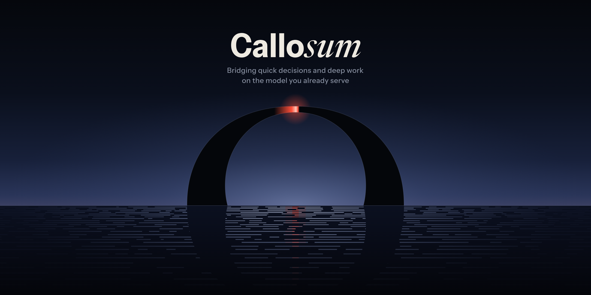
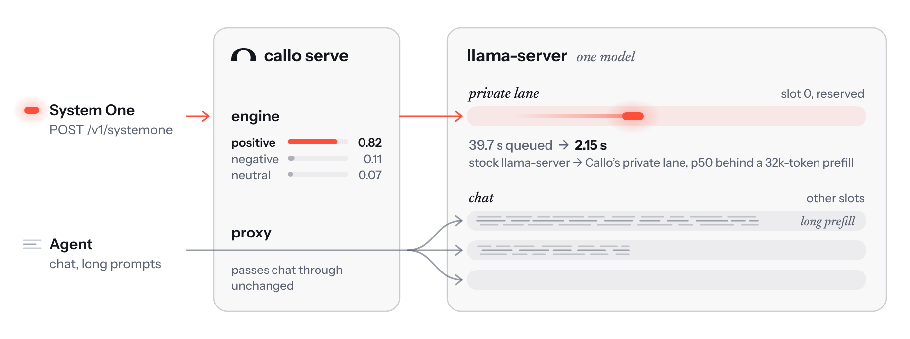

<p align="center"></p>

# Callosum: `callo`

A System One classifier returns a probability for every option the caller defines, in one forward pass. Callosum
(Callo for short; the command is `callo`) gives the model you already run that ability: it is a small server in
front of llama-server, your agent's traffic passes through it unchanged, and the same model answers System One
requests (`POST /v1/systemone`) with no second model in memory. Quick questions run on reserved slots, so they do
not wait for the agent's long prompts to finish. Optionally the model thinks briefly before it answers, within a
token budget or a time limit.

<picture><source media="(prefers-color-scheme: dark)" srcset="brand/how-it-works-dark.png"></picture>

## Features

- **System One API on any chat GGUF** llama-server can serve: per-option probabilities from the model's own
  next-token logprobs, no training.
- **A private lane:** classification runs on reserved slots, so it does not wait for the agent's prefills to finish.
- **Images, audio and video**, whichever the model's projector takes.
- **Think budgets and deadlines:** the model reasons for up to N tokens or M milliseconds, or until its answer has
  settled, then answers.
- **Calibration:** temperature and position-bias fits on your own data; `callo compare` picks a model and budget by
  your accuracy/latency trade-off.
- **Transcription** pinned to one home agent slot, off the reserved slots.
- **Launch or attach:** Callo starts llama-server with the right flags, or fronts one you already run.

## Use cases

- Flag dangerous terminal commands in a coding-agent harness before they run.
- Triage tickets.
- Play games in real time.
- Drive a browser.
- Classify documents, images, audio transcripts and video.

All of it runs while the same model keeps working as your agent.

## Quickstart

Runs on Linux and macOS. Windows support is coming; for now, run Callo under WSL2. Needs Python 3.10 or later,
and `llama-server` (llama.cpp) on your `PATH` for launch mode.

```
pip install callo
callo serve --model Qwen3.5-9B-Q8_0.gguf            # launch mode: starts llama-server for you
# or
callo serve --upstream http://127.0.0.1:8199         # attach mode: your running llama-server
echo "The package arrived two weeks late." | callo classify --options positive,negative,neutral
```

Callo listens on `http://127.0.0.1:8180` by default (not 8080, llama-server's own default). Point the agent at it;
nothing else changes. Attach mode needs llama-server started with
[specific flags](docs/guide/serving.md#required-llama-server-configuration).

## Why

An agent spends most of its time on slow work: long prompts, long answers. But it, and the tools around it, also need
quick judgements all the time. Is this message positive or negative? Which of these four tools fits? Which way should
the character move? The usual answer is a dedicated System One classifier (Jev/Kev, Clef-Flash), which returns
calibrated probabilities over your options in one forward pass, but runs as a second model next to your agent's, or
in the cloud.

The model you already run can give those probabilities itself, through llama.cpp's logprobs. With no training,
Qwen3.5-9B scored within noise of Clef-Flash on the same backbone across six public classification benchmarks
(+0.4 pp, 95 % CI [−2.7, +3.5]), and one fitted temperature made its calibration indistinguishable from the trained
classifier's. What it lost (−5.5 pp overall) was multi-step rule logic, which is what think budgets are for.

Two things stand in the way on stock llama.cpp. It has no System One API for generative models, only next-token
logprobs. And a quick question waits behind whatever the agent is prefilling: llama-server fills each batch slot by
slot in id order, so a classification queued behind a 32k-token prefill waited 39.7 s. Callo adds the API and
reserves the lowest slot ids for classification, with no llama.cpp patch or fork. Through Callo, on the same model,
classifications under a continuous 32k-token agent prefill took 2.15 s (p50 over 100 requests).

## How it works

<picture><source media="(prefers-color-scheme: dark)" srcset="brand/how-it-works-dark.png"></picture>

`callo serve` holds two parts in front of one llama-server and one model:

- **The proxy** relays every request, streaming included, and stamps `id_slot` on the agent's completion and chat
  requests so they stay off the reserved slots. It picks slots the way llama-server does (longest common prefix, then
  least recently used), so the agent's prompt cache keeps working.
- **The engine** answers `POST /v1/systemone`: it renders the question into the model's own chat template, reads the
  next-token distribution at the answer slot, sums every spelling of each option's letter, and renormalises over the
  options. Every option gets a probability, not just a best-guess token.

`GET /callo/stats` reports routing, latency, the loaded profiles and what the startup self-tests found
([field reference](docs/guide/stats.md)).

## Features in detail

### The System One API

A System One request names the input (`state`) and one or more questions with their options. The response has the
System One shape (`model`, `answers`, `usage`), and every answer carries per-option probabilities. Callo adds
`context`, text placed in the cached system turn so a repeated prefix is not re-read, and, with
`--s1-slots` 2 or more, lanes (`X-Callo-Conversation`) that keep separate cached prefixes on separate reserved slots
(with one reserved slot, requests round-robin). Questions can have up to 255 options.

```
curl -s localhost:8180/v1/systemone -d '{"state": "The package arrived two weeks late.",
  "questions": {"tone": {"type": "choice", "criteria": {"positive": null, "negative": null, "neutral": null}}}}'
```

The rendered prompt is a public contract. Errors, the `X-Callo-Timings` diagnostics header and the in-process engine
are in the [API reference](docs/guide/api.md).

### Images, audio and video

Start the model with its multimodal projector and send data URLs in `images`, `audio` or `videos` (up to 8 items in
all). Callo detects at startup which modalities the model takes and self-tests each one.

```
callo serve --model M.gguf --mmproj mmproj.gguf
callo classify --image frame.png --options up,down,left,right --instructions "Which way?" < /dev/null
callo classify --audio clip.wav --options speech,music,silence --instructions "What is in the clip?" < /dev/null
```

Audio must be WAV, MP3 or FLAC; video needs ffmpeg and ffprobe on llama-server's `PATH`. Media encoding stalls every slot while it
runs. Details: [Images, audio and video](docs/guide/media.md).

### Think budgets and deadlines

A deliberate readout lets the model think first, then reads the answer after `</think>`. A **budget** caps the trace
in tokens; a **deadline** caps it in milliseconds, with the trace generated in chunks so the answer still lands in
time. Set any of them as a server default or per request (`think_budget`, `think_deadline_ms`, `think_converge`).
On a 376-question test set, Tiel-Coder 35B-A3B went from 0.832 to 0.941 accuracy at a 1024-token budget, at a mean of
1.9 s per question against 169 ms single-pass.

```
callo serve --model M.gguf --think-budget 256 --think-profile think/M.think.json
callo serve --model M.gguf --think-profile think/M.think.json --think-deadline 1800
callo serve --model M.gguf --think-profile think/M.think.json --think-converge 0.95
```

A deadline or an early-exit target set on the server applies to every client; a client opts out with
`"think_budget": 0`. A trace ends at the model's own closing tag, at the limit, or, with **early exit**, as soon as the
answer has settled: `callo calibrate --converge-probe` fits when to stop and whether it pays, and
`--think-converge 0.95` (or `"think_converge": 0.95`) serves it. Early exit is opt-in: calibrate and `callo compare`
never pick it, as its rule holds only on questions like the calibration data. An experimental gate,
`--think-converge-gate`, first asks the model whether a question needs several stated rules applied step by step, and
serves it without early exit when it does. Details: [Think budgets and deadlines](docs/guide/think-budgets.md).

### Calibration and `callo compare`

Served at T = 1 the readout is over-confident. `callo calibrate` fits one temperature on your labelled data,
`callo calibrate --bias` measures the model's preference for answer positions on your questions, and
`callo calibrate --think-budgets` measures accuracy and latency at each budget, for one model or a menu of several.
`callo compare` puts the resulting profiles on one accuracy/latency frontier and picks by your preference.

```
callo calibrate --data labelled.jsonl --out T.json     # against a running callo serve at T = 1
callo serve --model M.gguf --temperature 1.91           # restart with the fitted T
callo calibrate --think-budgets --data labelled.jsonl --model A.gguf --model B.gguf --out think/
callo compare think/A.think.json think/B.think.json --price 1
```

1.91 is the value fitted for Qwen3.5-9B, an example, not a default. Details: [Calibration](docs/guide/calibration.md),
[Position bias](docs/guide/position-bias.md), [`callo compare`](docs/guide/compare.md).

### Transcription

llama-server cannot pin a multipart `/v1/audio/transcriptions` request to a slot, so it can land on a reserved slot or
on an agent's cached conversation. Callo translates a well-formed request into the chat request llama-server builds
itself, pins it to the agent slots (one home slot for transcriptions without a conversation hint), and reshapes the
reply. Streaming and non-`json` formats pass through unpinned.

```
curl -s localhost:8180/v1/audio/transcriptions -F file=@clip.wav
```

Details: [Transcription](docs/guide/transcription.md).

### Launch and attach mode

`callo serve --model M.gguf` starts llama-server as `-np 4 -kvu --no-cache-idle-slots -b 512 -ub 512 --jinja
--slot-save-path ~/.cache/callo/slots`; anything after `--` is passed to llama-server last and wins.
`callo serve --upstream URL` fronts a llama-server you run, which must be started with those flags plus `--slots`.
`--s1-slots k` reserves slots `0..k-1` (default 1); mixing think budgets with fast traffic needs 2 or more.

```
callo serve --model M.gguf --ctx 65536 --s1-slots 2
```

Every flag, the startup sequence and per-slot KV (`--no-kvu`): [Serving](docs/guide/serving.md). Exit codes:
[Exit codes](docs/guide/exit-codes.md).

## Measurements

Measured on one Mac Studio M2 Ultra 64 GB. Runs through Callo used llama.cpp master `4ebdf2c`; the accuracy run and the
plain llama-server baselines used Homebrew build b9890; the Clef GGUFs ran on llama.cpp's native Clef path (build b11379).
Intervals are 95 % paired bootstrap. Full setups and more results: [Measurements](docs/guide/measurements.md).

<picture><source media="(prefers-color-scheme: dark)" srcset="brand/di-chart-dark@2x.png"></picture>

The models I daily-drive as agentic coders take about as long to give System One answers through Callo as dedicated
decision models take on llama.cpp's native Clef path, when neither thinks (Tiel-Coder 2.2 s against Clef-Flash 2.4 s
mean). Some accuracy is sacrificed, because current agentic coders are not trained for decisions, but I can't fit a
dedicated decision model that beats Qwen3.8-Flash-Next alongside it without sacrificing something more important, so
Callo wins on that trade for my use case.

With no thinking (Clef included), most of the time goes to prefilling long contexts; the decision itself is
near-instant. "Think 256 with early exit" reasons for up to 256 tokens but stops once the answer's log-probabilities
settle, here saving about 4 s a request on Tiel-Coder (13.9 s → 9.7 s mean) at the same index. Callo's "early exit +
gate" mode (on here for Qwen3.8-Flash-Next) first asks the model whether the question needs multi-step reasoning and, if
it does, turns early exit off, because early in such a chain of thought the probabilities can mislead ([Decision Index
details](docs/guide/measurements.md#decision-index)).

- **The private lane:** a classification behind a 32k-token agent prefill waited 39.7 s on plain llama-server; through
  Callo, the median is 2.15 s over 100 requests (3.29 s behind a 128k-token prefill).
- **Drop-in:** chat, tool-call and streaming output through Callo was identical to direct, and the agent's prompt
  cache survived a classification between turns.
- **Images:** Tiel-Coder read 36 of 36 maze frames correctly (mean probability on the answer 0.999), and held 2
  readouts a second (median 357 ms) while another slot streamed at 34.9 tok/s.
- **Think budgets:** on a 376-question test set, at a 1024-token budget, Tiel-Coder 0.832 → 0.941 (mean 169 ms →
  1.9 s), Dirk (Qwen3.8 27B) 0.830 → 0.941 (803 ms → 8.7 s), Qwen3.5-9B 0.763 → 0.928 (203 ms → 12.3 s) and
  Sharp-MiniCPM5-2B 0.577 → 0.870 (67 ms → 2.7 s), against 0.854 for Clef-Flash BF16 (286 ms). In other words, on short
  questions answers come quickly and accuracy saturates easily ([details](docs/guide/measurements.md#think-budgets)).
- **Position bias:** on held-out questions from ten public datasets, debiasing kept accuracy (+0.2 pp) and lowered
  NLL slightly on both models tested, with no extra upstream call.
- **Transcription:** on Gemma-4-E4B, 20 of 20 translated requests matched llama-server's own endpoint byte for byte in
  the prompt and word for word in the text.

## Limitations

The key caveats; every caveat, with its measurements, is in [Limitations](docs/guide/limitations.md).

- **Readouts and unified KV.** Under `-kvu` (launch mode's default), a readout on a MoE model can shift with what other
  slots hold: up to 0.34 in probability on Tiel-Coder 35B-A3B; a dense hybrid showed only noise. `--no-kvu` made text
  readouts bit-exact, at the cost of a fixed per-slot context.
- **Classification shares the GPU.** At about 3 classifications a second, 5 agent decode streams dropped from 30.7 to
  9.1 tok/s each.
- **Not pinned:** `/v1/messages` (Anthropic API, e.g. Claude Code), embeddings and rerank. Those can land on a
  reserved slot.
- **Reserved-slot fallback.** When a reserved slot is busy with a request Callo did not send, Callo moves the
  classification to the lowest-id idle slot (the fallback). That helps against a foreign decode, not a foreign
  prefill: llama-server fills each batch in slot-id order, so with a foreign 32k prefill in slot 0 a classification moved to slot 1 starves behind it just
  as one left on slot 0 waits for it: measured p50 39.2 s with fallback vs 41.0 s without (the prefill took
  42.1 s).
- **Media** encoding blocks every slot while it runs; video has no duration cap and is decoded by llama-server's
  ffmpeg, so do not accept video from senders you would not trust with it.
- **Cached readouts are not bit-stable.** The prompt cache is on by default and moves logprobs at about the 1e-2
  level; `--no-cache` restores bit-stable plain readouts.
- **Position-bias profiles** are only as good as the match between your calibration data and what you serve, and
  correct only the readout kinds that data contained.
- **Think budgets** are text only, one sample per question, and need a `<think>`-style block (Gemma 4 is served at
  budget 0 only). With `--s1-slots 1`, fast readouts wait behind a deliberate one.
- **KV capacity:** two long conversations whose KV exceeds `-c` together evict each other.
- **No auth, no TLS, no Windows**, HTTP/1.0 towards clients. `--slot-save-path` lets any client of Callo write a
  slot's KV cache to disk. Windows support is coming; for now, run Callo under WSL2.

## Future work

Callo opens the door to a new class of hybrid models trained simultaneously for decisions, concise reasoning and agentic
work. A multi-use model running on Callo could potentially close the accuracy gap to dedicated decision models while
maintaining its primary task performance.

Another hypothetical way of achieving SOTA accuracy on zero-token decisions while maintaining agentic coding performance
in the same model is to train an activated LoRA (aLoRA) for decisions that applies only after its trigger token, so it
is turned on only when the model processes System One requests. Using an aLoRA means the state before the trigger token
is read by the base model and its prompt cache is shared, which a plain LoRA swapped in per request would lose.

## Licence

The code is Apache-2.0, and the package (wheel and sdist) is code only, with the licence expression `Apache-2.0`.

The built-in position-bias set is not in the package: `callo calibrate --bias` fetches it on first use from the
Hugging Face dataset [`peculiar-ragdoll/callo-bias-set`](https://huggingface.co/datasets/peculiar-ragdoll/callo-bias-set),
pinned by commit and sha256. It carries MIT (MMLU) and CC-BY-4.0 (Banking77) data; [`NOTICE`](NOTICE) lists the data
files in this repository and their licences.

## Development

```
uv sync --group dev
make check          # ruff + pytest (fake upstreams only)
make release-check  # before publishing (network): the pinned HF bias-set revision is set, fetches, and verifies
make test-live      # needs the master llama-server build and a GGUF (set CALLO_BENCH_LLAMA_SERVER and CALLO_BENCH_MODELS: bench/README.md)
```

## Citation

If you use Callo in your work, please cite it:

```bibtex
@misc{ishtardottir2026callosum,
  title        = {Callosum: Bridging System One and Deep Work},
  author       = {Ishtardottir, Saga},
  year         = {2026},
  howpublished = {\url{https://github.com/peculiar-ragdoll/callosum}},
  note         = {Software, version 0.3.1. Python package \texttt{callo}}
}
```
