# Callosum brand (v2)

<p align="center"></p>

## Concept: a bridge over slow water

Callosum lets quick judgements cross over slow work without waiting behind it. The identity draws
that literally:

- **The scene.** A bridge at dusk. Under it, the slow tide: System Two's long prompts and long
  generations. Over it, quick lights: System One's instant, log-probability judgements. They cross the
  crown in under a second and never touch the water. That is the product: the fast path is routed
  *over* the slow one, not queued behind it.
- **The mark.** The same bridge, exactly as it stands in the plate: two heavy piers and a hairline
  crown. It is drawn from a reverse-contrast C turned on its side and cut at the waterline. That
  thick-ends, thin-middle profile is also the corpus callosum in a mid-sagittal MRI, thick at the
  genu and the splenium and slender in between. The span is the mark's own structure; nothing is
  bolted on. The mark is always one colour, in every size and file; the coral light lives only in
  the plates.
- **The wordmark: one word, two minds.** **Callo** is set in an upright grotesk, the quick and
  mechanical mind, which is also the command you type. *sum* is set in a written serif italic, the
  slow and deliberate mind. The italic is scaled so its x-height matches the grotesk exactly, and it
  is kerned in tight, so the word stays whole. You see `callo` at a glance because of a change of
  *kind*, not a change of weight.

## What the first identity lacked

The first identity was a disc split by a gap (the coronal section of the brain) with a coral square, a
weight-contrast wordmark and a plate of fibre lines. v2 is drawn against what it lacked:

1. **A sign, not a diagram.** A split disc reads as a pause button or an "H". The mark is now the
   bridge itself: a reverse-contrast silhouette with no added parts, the same object as the plate's
   bridge, so the mark and the scene read as one thing.
2. **The product, not the anatomy.** A symmetric, still disc has no tempo, and Callosum is about
   asymmetry (fast vs slow) and motion (one passing the other). The scene has a slow layer and a fast
   layer, and the fast one visibly passes over the slow one.
3. **A wordmark contrast that means something.** A heavy "Callo" beside a thin "sum" reads as two
   words and falls apart at small sizes. The contrast is now one of kind, upright grotesk against
   written italic: the two kinds of thinking.
4. **A place, not wallpaper.** Fibre lines could belong to any data or AI company, and the lockup sat
   on top of them. The plate is a place with a horizon, a light source and a reflection, and its
   motion has events: a light crosses every four seconds and glints in the water.

## Motion

One loop is 16 s and repeats seamlessly. It has three tempos:

| Layer | Tempo | What moves |
|---|---|---|
| Tide | one swell per 16 s | Each row of ripples drifts sideways on a sine, with a phase that rolls with depth. The bridge's dark reflection shimmers at its edges |
| Breath | one breath per 16 s | The horizon glow dims to 82 % and returns (ease-in-out) |
| Pulse | every 4 s, 1.4 s long | A coral light crosses the crown, alternating direction. It eases onto the bridge, is fastest at the top, and settles off the far side. Its comet tail points the way it came, and a coral glitter path follows it across the water |

- **At rest** (t = 0), light 0 sits on the crown. That frame is `plate.svg` and `plate@2x.png`.
- **CSS only.** No JS and no SMIL, so it animates inside a GitHub README ``.
- **Reduced motion.** Under `prefers-reduced-motion: reduce` every animation is switched off, and
  each element falls back to resting attributes that equal its 0 % keyframe.

Verified with `tools/export.py check`:

| Comparison | Result |
|---|---|
| `plate.svg` vs `plate-animated.svg` under reduced motion | 0 px differ |
| Loop seam, t = 0 vs t = 16 s | 0 px differ |
| t = 0 vs t = 32 s | 0 px differ |

The *running* animation sampled at t = 0 differs from the static plate only by Chrome's compositor
anti-aliasing on moving layers. That shows up on isolated edge pixels (max Δ 36/255, mean 0.091),
and goes to 0 once the animation is cancelled.

## Palette

| Name | Hex | Role |
|---|---|---|
| Ink | `#14161D` | Mark and type on light backgrounds (GitHub `#ffffff`) |
| Bone | `#EEEAE1` | Mark and type on dark backgrounds (GitHub `#0d1117`) |
| Signal | `#FF4F3A` | The quick light: the only accent, used once per composition. In diffusion MRI, fibres that cross between hemispheres are drawn red; so is ours |
| Night | `#090B11` | Plate sky (top) |
| Dusk | `#2A3559` | Plate horizon glow |
| Tile | `#0E1322` | Favicon and app tile |
| Mist | `#8D95A6` | Secondary text on dark |
| Slate | `#5B6272` | Secondary text on light |

The data figures (`frontier.py`, `concurrency.py`, `di.py`) use these colours only: Signal for Callo's picked series, Ink or
Bone for type and the trained-head reference series, Mist on Night and Slate on Bone for secondary text (Mist on Bone
fails AA), Mist or Slate at low opacity for grid lines, and Dusk for the horizon glow.

The marks and lockups are one colour, Ink or Bone. Signal belongs to the light. Use it for the moving
pulse, a link or a focus ring; never tint the mark.

## Typefaces

| Use | Face | Setting | Licence |
|---|---|---|---|
| "Callo", UI | **Instrument Sans** (Instrument) | variable, wght 700, wdth 92 | SIL OFL 1.1, `fonts/OFL-InstrumentSans.txt` |
| "sum" | **Newsreader Italic** (Production Type) | variable, wght 500, opsz 72, x-height matched to Instrument Sans | SIL OFL 1.1, `fonts/OFL-Newsreader.txt` |

Both font files are in `fonts/` so the build can be reproduced. Every shipped SVG has its text
converted to outlines (HarfBuzz shaping, real kerning), so nothing depends on an installed font.

## Clear space and minimum size

The unit is **c**, the cap height of "Callo" in the lockup.

- **Clear space.** Keep 0.5 c clear on every side. The lockup SVGs already include it in their
  viewBox.
- **Construction (horizontal lockup).** The bridge stands on the wordmark's baseline like a letter.
  Its crown overshoots the cap height by 4 % (1.04 c tall, about 2.25 c wide), the way round
  letters overshoot. The gap between the pier and the "C" is 0.38 c: the pier's straight inner face
  reads as a stem, so it is spaced like a tight word space.
- **Construction (stacked lockup).** The bridge is centred over the word and is 0.44 of the word's
  width, about as wide as "Callo". It stands 0.5 c above the cap height.
- **Minimum size, lockup.** 24 px tall (c ≈ 11 px). Below that, use the wordmark alone, or the mark
  alone.
- **Minimum size, mark.** 16 px. The mark has optical sizes, like a typeface:
  - `display` (≥ 128 px): the crown is a true hairline.
  - `text` (lockups): the crown is heavier.
  - `small` (32 px) and `favicon` (16 px): heavier again, and these two stand on piers 14 % and
    30 % longer, because a 2.2 : 1 arch would otherwise be only 5 px tall at 16 px.
- **Backgrounds.** Use the light files on `#ffffff` and the dark files on `#0d1117`. The plate and
  the favicon tile carry their own background and work on both.

On GitHub, with light and dark themes:

```html
<picture>
  <source media="(prefers-color-scheme: dark)" srcset="brand/lockup-dark.svg">
  
</picture>
```

For the README's "How it works" illustration (transparent PNGs, 2x; GitHub shows the PNG, so the text in it is
outlined and needs no font):

```html
<picture>
  <source media="(prefers-color-scheme: dark)" srcset="brand/how-it-works-dark.png">
  
</picture>
```

For the README hero (also the GitHub social preview; upload `plate@2x.png` there):

```html
<p align="center"></p>
```

## Files

| File | What it is |
|---|---|
| `lockup-light.svg`, `lockup-dark.svg` | Horizontal lockup, mark then wordmark, outlined, transparent. SVG is the master |
| `lockup-light.png`, `lockup-light@2x.png`, `lockup-dark.png`, `lockup-dark@2x.png` | Lockup rasters at 1x and 2x |
| `lockup-stacked-light.svg`, `lockup-stacked-dark.svg` (+ `@2x.png`) | Stacked lockup: the bridge over the word |
| `mark-light.svg`, `mark-dark.svg`, `mark-light-512.png`, `mark-dark-512.png` | Standalone square mark, display optical size, one colour, transparent |
| `favicon.svg`, `favicon-32.png`, `favicon-16.svg`, `favicon-16.png` | Favicons on a Tile background, so one file works on light and dark browser chrome; the 16 px one uses the `favicon` optical size |
| `plate.svg`, `plate@2x.png` | Static plate, 1280×640 (README hero, social preview) |
| `plate-animated.svg` | The same plate in motion. CSS only, 16 s seamless loop, rests on the static frame under reduced motion |
| `plate-loop.mp4`, `plate-loop.webp` | Loop renders: H.264 1280×640 at 30 fps; animated WebP 960×480 at 15 fps |
| `how-it-works-light.svg`, `how-it-works-dark.svg` (+ `.png` at 2x, 1840×688) | The README's "How it works" illustration, transparent, for GitHub's `#ffffff` and `#0d1117` pages. The plate's vocabulary: chat is the slow tide, the System One question is the quick coral light on its private lane (slot 0), and `callo serve` carries the mark |
| `preview.html` | Self-contained page: everything on light and dark, small and large, with the animation running |
| `build.py` | Writes every SVG and `preview.html` from code: palette, mark geometry, wordmark, lockup, plate |
| `tools/geom.py`, `tools/glyphs.py`, `tools/plate.py` | Mark geometry (a reverse-contrast superellipse C, turned and cut into the bridge), HarfBuzz text to outlines, and the plate scene with its keyframes |
| `tools/render.py`, `tools/export.py` | Headless Chromium rendering, the PNG exports, the loop checks, and the MP4/WebP encode |
| `fonts/` | Instrument Sans, Newsreader Italic, and their OFL licences |
| `frontier.py` | The release plate generator: accuracy against per-decision latency, Callo's thinking budgets beside trained decision heads. `build` computes everything with Callo's own `compare`/`think` code from a spec (`data/frontier.release.spec.json`) into `data/frontier.json`; `draw` bakes `frontier-{dark,light}[-p50\|-p95].svg` (and `@2x.png` with `--png`) from that snapshot alone |
| `concurrency.py` | The companion figure generator: decisions while an agent shares the GPU, from existing results. `build` re-verifies every number of the benchmark's `extract_concurrency.py` output under `--root` against its source file and JSON pointer into `data/concurrency.json`; `draw` bakes `concurrency-{dark,light}.svg` |
| `di.py` | The Decision Index plate generator, the headline release figure: the DI 0.3 public-subset index against the mean request completion time, Callo's thinking budgets as two-point lines beside dedicated decision models (Clef, d1-3B) as single markers, the five area skills as small multiples, and a table. `build` reads the benchmark's DI outputs under `--root` (`di_bootstrap.py`, `di_union.py`, each arm's `di_meta.json`) from a spec (`data/di.release.spec.json`) into `data/di.json`, refusing a stale bootstrap or an arm with unexplained errors; `draw` bakes the plate, `di-{dark,light}.svg`, and the README's chart, `di-chart-{dark,light}.svg` (the same plot alone under one title), and `@2x.png` of each with `--png`, from that snapshot alone |
| `how_it_works.py` | The "How it works" illustration generator (`build.py` writes its SVGs, `tools/export.py pngs` its PNGs; or standalone: `python brand/how_it_works.py [--png]`) |
| `figkit.py` | Shared figure kit: the palette as dark and light themes, HarfBuzz outline text (with a drawn Δ), log scales, the label placer, the Playwright render |
| `figures_md.py`, `FIGURES.md` | "How these figures were made": builds, GiB, each arm's runtime and timer, the seed, compare's flags, the fallback case, the README's limit, the run-to-run floor and the gaps, the DI plate's two treatments and per-arm provenance, generated from the snapshots |
| `data/` | The figures' committed snapshots (every source path relative to the build's `--root`), the plates' specs, and `builds.json`: the Callo builds the figures were measured on, named by role (their commits are of the development history and listed once in `FIGURES.md`) |
| `tests/` | The figures' information-contract tests (`uv run --with fonttools --with uharfbuzz --with pillow pytest brand/tests`; the real-data tests run when `CALLO_BENCH_ROOT` and `CALLO_PLATE_RESULTS` point at the benchmark's results, and skip otherwise) |

## Rebuilding

```sh
python3 -m venv .venv && .venv/bin/pip install fonttools uharfbuzz playwright pillow
.venv/bin/python -m playwright install chromium
.venv/bin/python brand/build.py                 # SVGs + preview.html
.venv/bin/python brand/tools/export.py pngs     # PNG rasters
.venv/bin/python brand/tools/export.py check    # rest frame and loop-seam pixel diffs
.venv/bin/python brand/tools/export.py video    # MP4 (ffmpeg) + WebP (img2webp); needs both on PATH
.venv/bin/python brand/build.py                 # again, so preview.html embeds the final files
```

The video step writes its frames to `$CALLO_TMP`, which defaults to `callosum-brand` in the system temp directory
(Python's `tempfile.gettempdir()`), and deletes them when it finishes.

The data figures (`frontier.py`, `concurrency.py`, `di.py`) rebuild from their snapshots alone; how each snapshot was
built from the benchmark's results is in [FIGURES.md](FIGURES.md).
